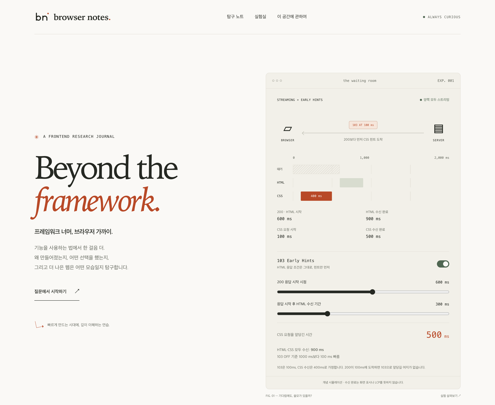

# Browser Notes

> 프레임워크 너머, 브라우저 가까이.

**https://browser-notes-alpha.vercel.app**

## 왜 시작했나

AI와 함께 일하면서 코드를 쓰는 일은 확실히 쉬워졌습니다. 만들고 싶은 것을 설명하면 금방 동작하는 코드가 나오고, 처음 보는 라이브러리도 짧은 시간 안에 손에 익습니다. 생산성은 분명히 올라갔습니다.

그런데 만드는 속도가 빨라질수록 한 가지가 더 또렷해졌습니다. 그 사이에도 웹은 계속 움직이고 있다는 것입니다. 브라우저에는 새로운 API가 들어오고, 리소스를 가져오는 방식과 화면을 그리는 방식이 조금씩 바뀝니다. 프레임워크의 새 기능도 들여다보면 결국 브라우저가 새로 할 수 있게 된 일을 감싼 경우가 많습니다. 도구는 바뀌어도 그 아래에서 일하는 것은 언제나 브라우저입니다.

그래서 프레임워크의 사용법을 따라가기보다, 브라우저 자체의 흐름에 조금 더 집중해 보려고 합니다.

- 지금의 브라우저에서 아쉬운 점, 개선됐으면 하는 점은 무엇인지
- 새로 들어오는 기능은 어떤 문제를 풀기 위해 만들어졌는지
- 웹 플랫폼은 지금 어느 방향으로 흘러가고 있는지

이런 질문을 꾸준히 관찰하고 기록하면서, 그만큼 쌓인 이해를 제 프로젝트와 회사 프로젝트로 다시 가져가 더 좋은 서비스를 만드는 것이 이 공간의 목표입니다.

## 무엇을 관찰하나

| 주제 | 질문 |
| --- | --- |
| 로딩과 네트워크 | 언제, 무엇을 가져오는가? |
| 렌더링과 인터랙션 | 어떤 과정으로 보이고 반응하는가? |
| 웹의 경계 | 브라우저는 어디까지 책임져야 하는가? |

지금 펼쳐 둔 질문들입니다.

- [HTML을 이미 스트리밍하고 있다면, Early Hints는 어떤 기다림을 더 줄일 수 있을까?](https://browser-notes-alpha.vercel.app/notes/early-hints)
- [화면 전환의 주인은 누구여야 할까?](https://browser-notes-alpha.vercel.app/notes/view-transitions)
- [클릭을 예측하는 웹은 어디까지 친절한가?](https://browser-notes-alpha.vercel.app/notes/speculation-budget)

## 기록하는 방식

1. **사용법보다, 존재 이유를.** 새 API를 만나면 그것이 풀려던 문제부터 따라갑니다.
2. **프레임워크는 하나의 사례로.** 브라우저와 HTTP의 원리를 중심에 두고, 도구가 그 원리를 어떻게 드러내거나 감추는지 비교합니다.
3. **데모와 증거를 구분하기.** 시뮬레이션은 이해를 돕고, 측정은 주장을 검증합니다. 확인한 환경과 버전을 함께 남깁니다.
4. **AI와 만들고, 판단은 내가.** AI는 구현과 탐색을 돕는 협업자입니다. 가설을 고르고 근거를 검토하고 결론에 책임지는 일은 제 몫으로 남깁니다.

> 빠르게 만드는 시대에, 깊이 이해하는 연습.
